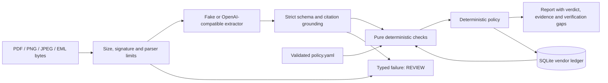

# Preflight

Pre-payment invoice verification with cited evidence. Deterministic code decides
PASS / REVIEW / BLOCK; language models only extract data.

**Implemented through M3:** strict models, identifier validation, seven pure checks,
SQLite ledger, validated YAML policy, bounded PDF/image/email ingestion,
fixture and OpenAI-compatible extractors, and the complete verification pipeline.
The web UI, Docker runtime and scored evaluation harness remain M4-M5 work.

## Development

Requires Python 3.12 and uv.

```sh
uv sync --locked --group dev
make check
uv run --locked pytest tests/test_pipeline.py -q
```

Checks run Ruff lint/format, strict mypy on the complete core package, and pytest.
Tests prohibit DNS lookup, socket connections and datagrams; provider tests use
HTTPX MockTransport. No model, API key, server or external document is needed.

## Verification flow



The entry point is `preflight.pipeline.run`. Supply an `Upload`, optional original
email, an open `Ledger` context, `load_policy()`, and an explicit extractor.
`tests/test_pipeline.py` provides runnable examples, including bank-change BLOCK
and prompt-injection regression cases. Tests and later evaluation use FakeExtractor.

Bank approval is separate: derive canonical identifiers using
`bank_identifiers(invoice.bank)`, verify them through a trusted human channel,
then call `ledger.approve_bank_account(vendor_id, identifier)`.
Extraction and pipeline execution never approve bank details.

## Model provider

OpenAICompatibleExtractor.from_env() reads:

| Variable | Meaning |
| --- | --- |
| PREFLIGHT_BASE_URL | Endpoint API root, including /v1 when needed |
| PREFLIGHT_MODEL | Exact model name served by that endpoint |
| PREFLIGHT_API_KEY | Optional bearer key; may be absent for local endpoints |

An Ollama or vLLM endpoint can run locally; no hosted provider is required.
The provider requests /chat/completions with JSON-schema output, then validates
locally. Endpoints must support that structured-output interface. Image inputs
also require a vision-capable served model.
Document content appears only in a JSON-escaped, explicitly untrusted user block.
The constant system prompt carries no document content. Invalid output gets one
schema retry; transient transport/status failures get at most three attempts
with 1/2-second backoff. Each request has a 30-second timeout and a 1 MB response
cap. Redirects are disabled. Error reports omit raw provider responses and keys.
Provider execution is opt-in; files leave the machine only if a remote endpoint
is explicitly configured and invoked.

## Policy and evidence

Configuration lives in data/policy.yaml and is validated before use.
Critical findings BLOCK. Any high finding or score at the REVIEW threshold
requires REVIEW. Pressure language contributes only low weight and is capped.
An empty or entirely unverifiable result requires REVIEW.
A partially verified PASS always carries its unverifiable checks. Missing core
vendor/number/currency/total fields require REVIEW and are not fabricated for storage.

Every populated extracted field must have a real dotted field path and a verbatim
source snippet containing its value. Page citations are checked against the
specified page. Invalid or missing evidence produces REVIEW before checks or ledger
writes. Missing-input findings cite an actual document excerpt, rather than an
invented snippet of absent data.

## Limits and weaker signals

- Checksum/format validity does not establish registration, ownership or invoice
  authenticity. IBAN validates generic shape/mod-97, not a country BBAN registry.
  IFSC and UPI do not query a bank/PSP registry. Printed IBAN spacing is accepted.
- Text-layer PDF processing uses PyMuPDF. Scanned PDFs or any blank-text page
  return ocr_unavailable. PNG/JPEG can be sent to vision extractors, but without OCR
  their textual citations cannot be verified; the pipeline requires REVIEW.
- Uploads are capped at 10 MiB, PDFs at 100 pages, extracted text at 200,000
  characters, email attachments at 10, and MIME parts/depth at 100/20. These are
  parser guards, not an OS-level CPU/memory sandbox for native PDF parsing.
- Email uses stdlib parsing and a header heuristic because RFC email has no unique
  binary magic signature. Attachments stay in memory; names never become paths.
  Nested emails are rejected; multiple invoice attachments require explicit selection.
- Authentication-Results in uploaded email can be forged. Reported failures are
  warning signals; claimed passes do not establish trusted SPF/DKIM/DMARC status.
- Lookalike detection decodes IDNA, folds common confusables and zero-width
  characters, then uses full-domain edit distance. It can miss unfamiliar scripts
  and flag legitimate similar domains. Display-name checks are heuristic.
- Anomaly checks require five prior same-currency PASS invoices. Zero MAD with a
  changed amount is conservatively high. A poisoned/incorrect ledger weakens all
  vendor-baseline checks; vendor names are local lookup keys, not verified identity.
- Citation checks prove text presence, not correct semantic field association.
  A model can cite a real but wrong number. Synthetic unit tests do not establish
  real-world fraud accuracy; measured evaluation is M5.
- Failed extraction cannot populate an invoice row. Reports carry failure reasons;
  successful grounded invoices, including REVIEW/BLOCK, are recorded as observations.

See DESIGN.md and AGENTS.md for assumptions and contributor conventions.
The existing Android starter is preserved locally and excluded from Preflight commits.
